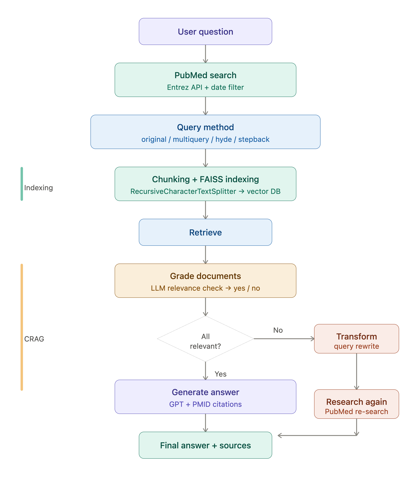
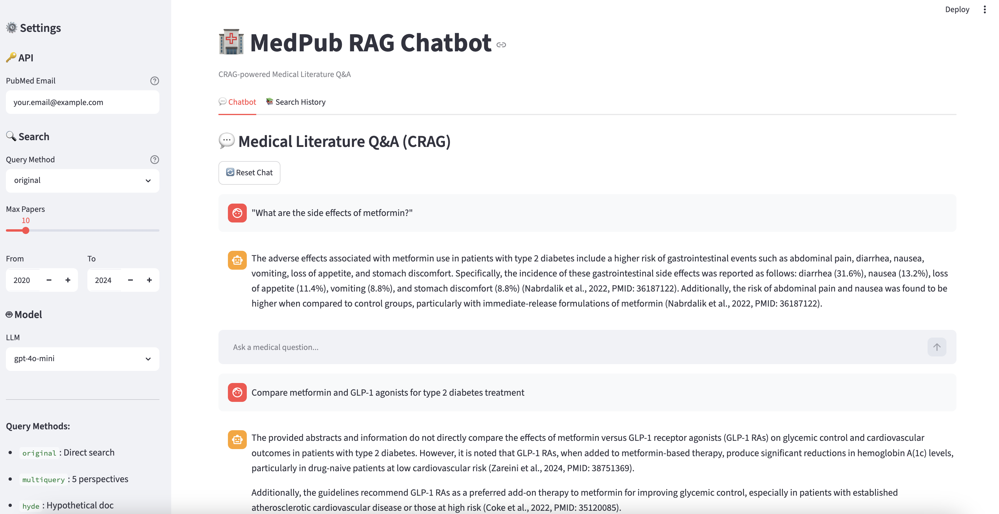

# MedPub RAG Answering Chatbot


## Project Summary
This project is a RAG-based medical question-answering system that uses only PubMed papers to reduce AI hallucinations and provide reliable medical information. Every answer includes the PMID, author, and publication year as evidence. It also uses a CRAG (Corrective RAG) pipeline to evaluate the relevance of retrieved papers and automatically re-search when irrelevant results are found. In addition, the system improves retrieval accuracy by applying multiple query strategies such as Multi-Query, HyDE, and Step-Back.

<<<<<<< HEAD
The pipeline runs as a **FastAPI service** with a **Streamlit front end**, packaged in **Docker**, tested offline in **GitHub Actions**, and deployable to Render.

> Not medical advice. Answers summarise published literature.

## Architecture

```
Streamlit UI (app.py)  ──HTTP──▶  FastAPI (api/main.py)  ──▶  medpub/ pipeline
                                   /health, /ask              PubMed → FAISS → CRAG → answer
                                   access code, daily limit
```

| Path | Role |
|------|------|
| `medpub/pubmed.py` | PubMed search through Entrez |
| `medpub/indexing.py` | Chunking and per-question FAISS index |
| `medpub/queries.py` | Original, Multi-Query, HyDE, Step-Back |
| `medpub/crag.py` | LangGraph CRAG graph (grade → rewrite → re-search) |
| `medpub/generation.py` | Grounded answer with PMID citations |
| `medpub/pipeline.py` | `answer_question()`: the single entry point |
| `api/main.py` | FastAPI service |
| `app.py` | Streamlit UI calling the API |
| `tests/` | Offline tests (fake PubMed, fake LLM, fake embeddings) |

## Flow


## Methodology
- Step 1. PubMed Search
  - Search PubMed in real time using the Entrez API. Retrieve relevant papers based on the user's question.

- Step 2. Query Strategy Select one of the following retrieval strategies to improve search quality:
  - Original – Search using the original question.
  - Multi-Query – Generate multiple query variations with an LLM (the original question is searched too).
  - HyDE – Generate a hypothetical document to improve semantic retrieval.
  - Step-Back – Reformulate the question into a higher-level concept before searching.

- Step 3. Document Indexing
  - Split retrieved abstracts into chunks. Convert chunks into embeddings. Store embeddings in a FAISS vector database.
=======
## Flow


## Methodology 
- Step 1. PubMed Search
  - Search PubMed in real time using the Entrez API. Retrieve relevant papers based on the user's question.
  
- Step 2. Query Strategy Select one of the following retrieval strategies to improve search quality:
  - Original – Search using the original question.
  - Multi-Query – Generate multiple query variations with an LLM.
  - HyDE – Generate a hypothetical document to improve semantic retrieval.
  - Step-Back – Reformulate the question into a higher-level concept before searching.
    
- Step 3. Document Indexing
  - Split retrieved abstracts into chunks. Convert chunks into embeddings. Store embeddings in a FAISS vector database.
  
- Step 4. Retrieval
  - Perform similarity search on the FAISS index. Retrieve the most relevant documents.

- Step 5. Document Grading (CRAG)
  - Evaluate the relevance of retrieved documents using an LLM. Trigger a new search if the retrieved documents are insufficient or irrelevant.

- Step 6. Query Refinement
  - Rewrite the query based on the grading results. Re-search PubMed and retrieve improved documents when necessary.

- Step 7. Answer Generation
  - Generate the final answer using the retrieved evidence. Include PMID, author, and publication year for every reference.
  - Return "Insufficient evidence" when reliable evidence is unavailable to reduce hallucinations.


## Tech Stack

| Category | Technology |
|----------|------------|
| **LLM** | GPT-4o-mini (OpenAI) |
| **Framework** | LangChain, LangGraph (CRAG) |
| **Vector Database** | FAISS |
| **Embeddings** | OpenAI Embeddings |
| **Data Source** | PubMed API (Entrez) |
| **Frontend** | Streamlit |
</p>

## How to run

### 1. Clone the Repository

```bash
git clone https://github.com/your-username/medpub-crag-chatbot.git](https://github.com/joanna-jaeeun/Medpub_RAG_Chatbot.git
cd medpub-crag-chatbot
```

### 2. Create a Conda Environment

```bash
conda create -n medpub python=3.11
conda activate medpub
```

### 3. Install Dependencies

```bash
pip install streamlit langchain langgraph faiss-cpu biopython \
    langchain-openai langchain-community \
    langchain-text-splitters python-dotenv
```

> Or simply install all dependencies with:

```bash
pip install -r requirements.txt
```

### 4. Set Up the API Key

Create a `.env` file in the project root and add:

```env
OPENAI_API_KEY=your_api_key
```

### 5. Run the Application

```bash
streamlit run app.py
```

## Chatbot

>>>>>>> 1b1d89220ee180191ad62eb99962ee68fd47be55

- Step 4. Retrieval
  - Perform similarity search on the FAISS index. Retrieve the most relevant documents.

<<<<<<< HEAD
- Step 5. Document Grading (CRAG)
  - Evaluate the relevance of retrieved documents using an LLM. Trigger a new search if the retrieved documents are insufficient or irrelevant.

- Step 6. Query Refinement
  - Rewrite the query for the corrective PubMed search. The final answer is still written for the user's original question.

- Step 7. Answer Generation
  - Generate the final answer using the retrieved evidence. Include PMID, author, and publication year for every reference.
  - Return "Insufficient evidence" when reliable evidence is unavailable to reduce hallucinations.

## Tech Stack

| Category | Technology |
|----------|------------|
| **LLM** | GPT-4o-mini (OpenAI) |
| **Framework** | LangChain, LangGraph (CRAG) |
| **Vector Database** | FAISS |
| **Embeddings** | OpenAI Embeddings |
| **Data Source** | PubMed API (Entrez) |
| **API** | FastAPI, Uvicorn |
| **Frontend** | Streamlit |
| **Ops** | Docker, GitHub Actions, Render |

## How to run

### 1. Clone and install

```bash
git clone https://github.com/joanna-jaeeun/Medpub_RAG_Chatbot.git
cd Medpub_RAG_Chatbot
python3.11 -m venv .venv && source .venv/bin/activate
pip install -r requirements.txt
```

### 2. Set environment variables

```bash
cp .env.example .env    # then fill in OPENAI_API_KEY and ENTREZ_EMAIL
```

| Variable | Purpose |
|----------|---------|
| `OPENAI_API_KEY` | Required for embeddings, grading and answers |
| `ENTREZ_EMAIL` | NCBI asks Entrez clients to identify themselves |
| `APP_ACCESS_CODE` | Optional. If set, `/ask` needs header `X-Access-Code` |
| `DAILY_LIMIT` | Questions per client IP per day (default 30, 0 = unlimited) |

### 3. Start the API and the UI

```bash
uvicorn api.main:app --reload            # http://localhost:8000/docs
API_URL=http://localhost:8000 streamlit run app.py
```

Or both with Docker:

```bash
docker compose up --build                # API :8000, UI :8501
```

## API

```bash
curl -X POST localhost:8000/ask \
  -H "Content-Type: application/json" \
  -d '{"question": "Does metformin reduce cardiovascular events in type 2 diabetes?",
       "query_method": "multiquery", "max_results": 10, "start_year": 2020}'
```

Response:

```json
{
  "answer": "… (PMID 12345678, Smith et al., 2022) …",
  "sources": [{"pmid": "12345678", "title": "…", "authors": "…", "journal": "…", "year": "2022", "abstract": "…"}],
  "nodes": ["retrieve", "grade_documents", "generate"],
  "n_papers": 10,
  "latency_s": 8.4
}
```

| Status | Meaning |
|--------|---------|
| 401 | Access code missing or wrong |
| 422 | Invalid request (e.g. unknown `query_method`, `start_year` after `end_year`) |
| 429 | Daily limit reached |
| 502 | PubMed unavailable |
| 503 | Server has no OpenAI key |

## Tests and CI

```bash
pytest -q
```

The tests replace PubMed, OpenAI and embeddings with fakes, so they run offline in about a second and need no API key. They cover PubMed record parsing, chunking, every query strategy, both CRAG paths (relevant documents → generate; irrelevant → rewrite → re-search → generate), and the API's validation, access code and rate limit.

GitHub Actions runs the tests on every push, then builds the Docker image and checks `/health` in the running container.

## Deploy (Render)

1. Push this repository to GitHub.
2. In Render: **New → Blueprint**, select the repository. `render.yaml` creates `medpub-api` and `medpub-ui`.
3. Set `OPENAI_API_KEY`, `ENTREZ_EMAIL` (and optionally `APP_ACCESS_CODE`) on `medpub-api`.
4. Set `API_URL` on `medpub-ui` to the API's public URL.
5. In each service's settings, set **Auto-Deploy** to deploy after CI checks pass.

Free instances sleep when idle, so the first request after a pause can take a while.

## Chatbot


## Next steps
- Evaluation set (≈20 questions with expected PMIDs and key points): retrieval hit rate / MRR in CI, faithfulness and answer relevancy before merge
- Structured answers: short summary plus an evidence table (study type, population, finding)
- Compare Original, Multi-Query, HyDE and Step-Back on the same evaluation set

=======
>>>>>>> 1b1d89220ee180191ad62eb99962ee68fd47be55
## References
- [Learn RAG From Scratch – Python AI Tutorial from a LangChain Engineer](https://youtu.be/sVcwVQRHIc8?si=oqVIXYPKKFFO18wy)
