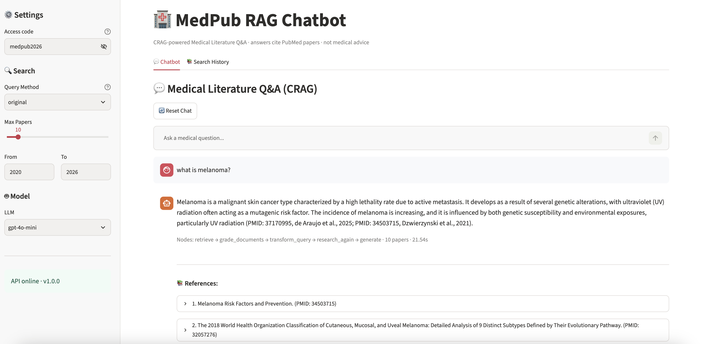
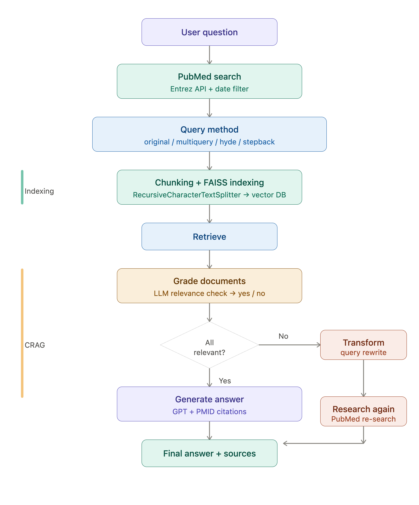

# PubMed-Powered Medical Literature RAG Chatbot


**Live demo:** https://medpub-ui.onrender.com (access code available on request)

> The demo runs on Render's free tier, so the first request after a quiet period can take about a minute while the server wakes up.
>
> Not medical advice. Answers summarise published literature.



## What it does

Ask a medical question and the chatbot searches **PubMed in real time**, keeps only the papers that are relevant, and answers **using those papers alone**. Every claim cites its source (PMID, first author, year). When the evidence is not there, it says **"Insufficient evidence"** instead of guessing.

Under the hood it is a **Corrective RAG (CRAG)** pipeline built with LangGraph. An LLM grades each retrieved excerpt; if the evidence is weak, the query is rewritten and PubMed is searched again. Four query strategies (Original, Multi-Query, HyDE, Step-Back) can be compared from the UI.

## Architecture

```
Streamlit UI (app.py)  ──HTTP──▶  FastAPI (api/main.py)  ──▶  medpub/ package
                                   /health, /ask              PubMed → FAISS → CRAG → answer
                                   validation, access code,
                                   daily limit
```

The UI holds no API keys and no RAG logic; it only calls the API. The RAG logic lives in a plain Python package, so the API, the tests and future evaluation scripts all call the same `answer_question()` function.

| Path | Role |
|------|------|
| `medpub/pubmed.py` | PubMed search through Entrez |
| `medpub/indexing.py` | Chunking and a per-question FAISS index |
| `medpub/queries.py` | Original, Multi-Query, HyDE, Step-Back |
| `medpub/crag.py` | LangGraph CRAG graph (retrieve → grade → rewrite → re-search → generate) |
| `medpub/generation.py` | Grounded answer with PMID citations and citation validation |
| `medpub/pipeline.py` | `answer_question()`: the single entry point |
| `medpub/config.py` | Settings from environment variables |
| `api/main.py` | FastAPI service |
| `app.py` | Streamlit UI calling the API |
| `tests/` | Offline tests (fake PubMed, fake LLM, fake embeddings) |
| `MedPub Rag Answering Chatbot.ipynb` | Original exploration notebook |

## How a question is answered



1. **PubMed search**: fetch up to N papers for the question within the chosen years (Entrez API).
2. **Indexing**: split abstracts into chunks, embed them with OpenAI embeddings and build an in-memory FAISS index for this question.
3. **Retrieval**: get the top-5 chunks using the selected query strategy.
   - *Original*: the question as asked
   - *Multi-Query*: the question plus LLM-generated rephrasings
   - *HyDE*: search with a hypothetical answer passage
   - *Step-Back*: search with a broader version of the question
4. **Grading (CRAG)**: an LLM judges each chunk as relevant or not.
5. **Correction**: if some chunks are irrelevant, rewrite the query, search PubMed again, and **grade the new chunks too**. The rewritten query is used only for searching; the answer is always written for the user's original question.
6. **Answer**: every chunk is sent to the LLM with a `[PMID | first author | year]` header, and the model may cite only PMIDs that appear in those headers.
7. **Citation check**: PMIDs in the answer are compared with the retrieved papers. Any that were not retrieved are returned as `invalid_citations`, logged, and shown as a warning in the UI.

## Lessons from testing the live app

- **Fabricated citations.** Early answers cited PMIDs such as `12345678 (Smith et al.)` that do not exist. The cause: only the first chunk of each abstract contains the PMID, so the model saw excerpts with no source and invented one. Fix: a source header on every chunk, a stricter prompt, and an automatic check of cited PMIDs against retrieved papers.
- **Unchecked re-search results.** Papers from the corrective search skipped grading, so off-topic papers (e.g. veterinary melanoma) reached the answer. They are now graded like the first batch.
- **Retrieval settings matter.** For *"Does metformin reduce cardiovascular events in type 2 diabetes?"*, the default settings (Original, 10 papers, 2020+) returned "Insufficient evidence", while Multi-Query with 30 papers from 2010 found three relevant papers including a meta-analysis. This motivates the evaluation set below.

## Run locally

### 1. Install

```bash
git clone https://github.com/joanna-jaeeun/Medpub_RAG_Chatbot.git
cd Medpub_RAG_Chatbot
python3.12 -m venv .venv && source .venv/bin/activate
pip install -r requirements.txt
```

### 2. Environment variables

```bash
cp .env.example .env    # then fill in OPENAI_API_KEY and ENTREZ_EMAIL
```

| Variable | Purpose |
|----------|---------|
| `OPENAI_API_KEY` | Required for embeddings, grading and answers |
| `ENTREZ_EMAIL` | NCBI asks Entrez clients to identify themselves |
| `APP_ACCESS_CODE` | Optional. If set, `/ask` needs the header `X-Access-Code` |
| `DAILY_LIMIT` | Questions per client IP per day (default 30, 0 = unlimited) |

### 3. Start the API and the UI

```bash
uvicorn api.main:app --reload                        # http://localhost:8000/docs
API_URL=http://localhost:8000 streamlit run app.py   # in a second terminal
```

Or both with Docker:

```bash
docker compose up --build                            # API :8000, UI :8501
```

## API

```bash
curl -X POST localhost:8000/ask \
  -H "Content-Type: application/json" \
  -d '{"question": "Does metformin reduce cardiovascular events in type 2 diabetes?",
       "query_method": "multiquery", "max_results": 30, "start_year": 2010}'
```

Response (abridged):

```json
{
  "answer": "… (PMID: 30672083, Charytan et al., 2019) …",
  "sources": [{"pmid": "30672083", "title": "…", "authors": "…", "journal": "…", "year": "2019", "abstract": "…"}],
  "nodes": ["retrieve", "grade_documents", "transform_query", "research_again", "generate"],
  "n_papers": 30,
  "latency_s": 17.8,
  "invalid_citations": []
}
```

| Status | Meaning |
|--------|---------|
| 401 | Access code missing or wrong |
| 422 | Invalid request (e.g. unknown `query_method`, `start_year` after `end_year`) |
| 429 | Daily limit reached |
| 502 | PubMed unavailable |
| 503 | Server has no OpenAI key |

## Tests

```bash
pytest -q
```

The tests replace PubMed, OpenAI and the embeddings with fakes, so they run offline in about a second and need no API key. They cover PubMed parsing, chunking, every query strategy, both CRAG paths (relevant → answer; irrelevant → rewrite → re-search → answer), grading of re-searched papers, citation headers and fabricated-citation detection, and the API's validation, access code and rate limit.

GitHub Actions runs the tests on every push, then builds the Docker image and checks `/health` in the running container.

## Deployment (Render)

`render.yaml` defines two free web services built from the same Docker image:

- `medpub-api`: FastAPI. Needs `OPENAI_API_KEY`, `ENTREZ_EMAIL` and optionally `APP_ACCESS_CODE`.
- `medpub-ui`: Streamlit. Needs `API_URL`, the API's public URL.

In Render: **New → Blueprint**, select this repository, fill in the variables and deploy.

## Known limitations

- Answers use abstracts only, not full texts.
- A new FAISS index is built for every question: always up to date, but each question pays for embedding (about 15–25 s per answer).
- The corrective search triggers whenever any retrieved chunk is judged irrelevant, so most questions re-search.
- The daily limit is kept in memory, so it resets on restart and is not shared between instances.

## Next steps

- **Evaluation set** (~20 questions with expected PMIDs and key points, including questions with no answer):
  - retrieval: PubMed recall, Hit@5, MRR
  - generation: fabricated-citation rate, faithfulness, key-point coverage, correct refusals
  - compare Original, Multi-Query, HyDE and Step-Back on the same set
- Tune the re-search threshold using the evaluation results (accuracy vs latency)
- Show cited papers separately from papers that were retrieved but not cited
- Structured answers: short summary plus an evidence table (study type, population, finding)

## References

- [Learn RAG From Scratch – Python AI Tutorial from a LangChain Engineer](https://youtu.be/sVcwVQRHIc8?si=oqVIXYPKKFFO18wy)
- [Corrective Retrieval Augmented Generation (Yan et al., 2024)](https://arxiv.org/abs/2401.15884)
